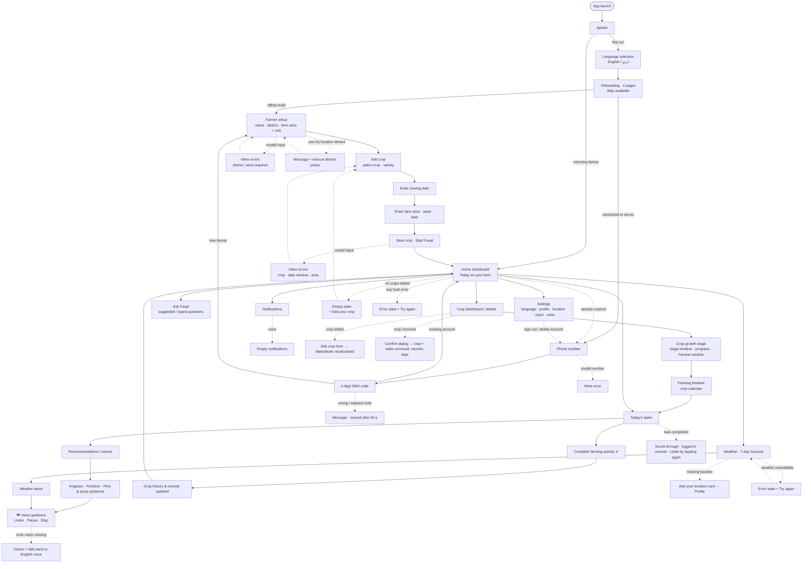

# FASAL — End-to-end farmer flow

Main flow (solid) and alternate flows (dashed). Matches the Phase 1 frontend.

## Notes

- **Language first:** the language screen comes before onboarding so the onboarding
  text is shown in the farmer's language (matches the reference design).
- **"Use my location"** is simulated in Phase 1 (returns a demo district and says so);
  GPS + permission handling arrive with the backend phase.
- **Ask Fasal** voice input is shown as "coming soon" — questions can be tapped or typed
  and are answered by clearly-labelled sample rules, not live AI.
